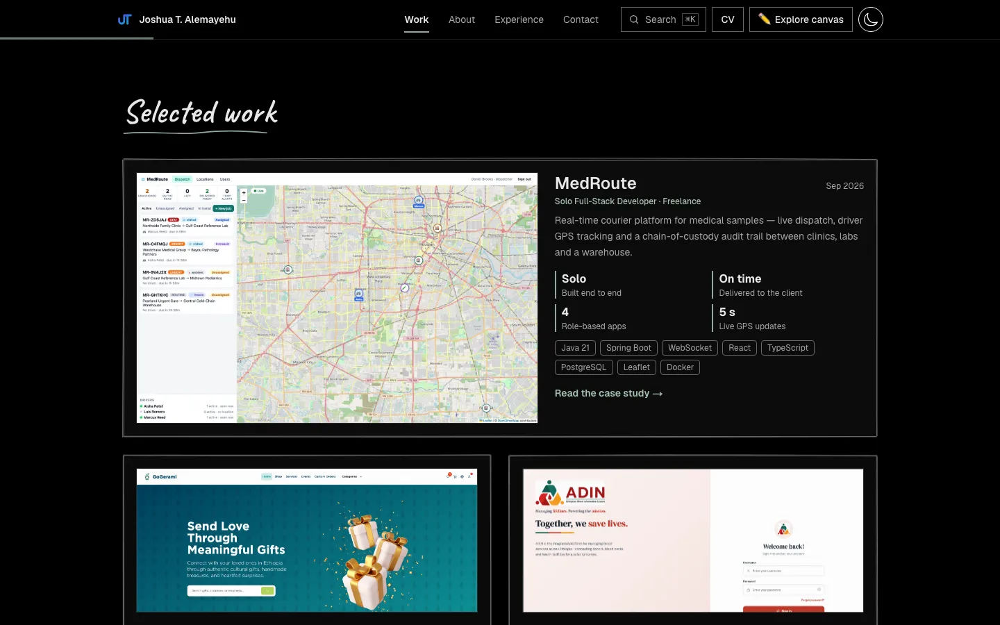
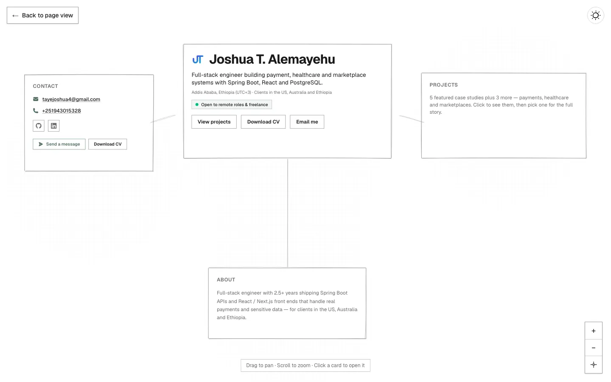

# Joshua T. Alemayehu — Portfolio

Personal portfolio of a full-stack engineer who builds payment, healthcare and marketplace systems with Spring Boot, React and PostgreSQL. It's a fast, server-rendered page by default, with an optional **"Explore as canvas"** mode that turns the portfolio into a pannable, hand-drawn sketch map.



## Features

- **Content-first page:** case studies, testimonial, skills, experience timeline and contact form, all server-rendered for search engines and link previews.
- **Explore as canvas** (screens ≥1024px): a zoomable sketch canvas (rough.js + react-zoom-pan-pinch) with zoom, recenter and keyboard controls. The choice is remembered without a layout flash.
- **Shareable case studies:** every project has its own `/projects/[slug]` page. Inside the site it opens as a modal through intercepting routes; shared links open the full page.
- **⌘K command palette:** jump to sections or projects, copy the email address, download the CV, and switch theme or layout.
- **Interactive skills:** each skill shows how many projects use it, and clicking one filters the work.
- **Contact form:** saves to MongoDB and/or emails through SendGrid, with validation, a honeypot field and per-IP rate limiting.
- **SEO and sharing:** generated Open Graph/Twitter images per page, `sitemap.xml`, `robots.txt`, canonical URLs and schema.org `Person` data.
- **Accessibility:** keyboard-navigable throughout (including the canvas), focus-trapped dialogs, reduced-motion support and AA colour contrast. Axe checks run in CI.



## Stack

Next.js 16 (App Router) · React 19 · TypeScript · Tailwind CSS 4 · Framer Motion · rough.js · react-zoom-pan-pinch · MongoDB · SendGrid · Playwright + axe · Vercel

## Getting started

```bash
pnpm install
cp .env.example .env   # optional: only needed for the contact form
pnpm dev               # http://localhost:3000
```

| Variable | Purpose |
|---|---|
| `MONGODB_URI` | Stores contact-form messages (optional if email is configured) |
| `SENDGRID_API_KEY`, `CONTACT_TO_EMAIL`, `CONTACT_FROM_EMAIL` | Emails each message to you (the sender must be SendGrid-verified) |
| `NEXT_PUBLIC_SITE_URL` | Absolute URL for metadata, sitemap and preview images, e.g. `https://example.com`. On Vercel it defaults to the production URL. |

## Scripts

| Command | What it does |
|---|---|
| `pnpm dev` | Development server |
| `pnpm build` / `pnpm start` | Production build / serve it |
| `pnpm lint` | ESLint |
| `pnpm typecheck` | TypeScript, no emit |
| `pnpm test:e2e` | Builds, then runs the Playwright smoke suite (desktop + mobile, including axe accessibility checks) |

CI (`.github/workflows/ci.yml`) runs lint, typecheck, build and the smoke suite on every pull request and on pushes to `main`.

## Editing content

All copy lives in [`app/lib/seed-data.ts`](app/lib/seed-data.ts): the hero, projects (with metrics, key decisions, galleries and testimonials), experience, skills, education and contact links. Project images go in `public/` as WebP. Larger originals are kept in `assets/originals/`, which isn't deployed. To show the CV button, put the PDF at `public/resume.pdf`.

## Project structure

```
app/
  page.tsx                     Home (scroll page + optional canvas), JSON-LD
  projects/[slug]/             Full case-study pages + their preview images
  @modal/(.)projects/[slug]/   Same case study as a modal (intercepting route)
  api/inquiry/route.ts         Contact form endpoint
  components/                  ScrollLayout, Canvas, CommandPalette, SiteHeader, ProjectCaseStudy, …
  lib/                         Content, validation, layout maths, UI store, hooks
e2e/                           Playwright smoke + accessibility tests
docs/PORTFOLIO_IMPROVEMENTS.md Review and improvement log
```
